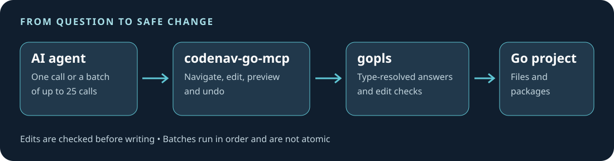

# codenav-go-mcp

[](https://pkg.go.dev/github.com/illescasDaniel/codenav-go-mcp)
[](https://github.com/illescasDaniel/codenav-go-mcp/releases)
[](https://github.com/illescasDaniel/codenav-go-mcp/actions/workflows/ci.yml)
[](LICENSE)

An MCP server that gives AI agents type-resolved Go navigation and editing through [gopls](https://pkg.go.dev/golang.org/x/tools/gopls). Find definitions, references, implementations and callers; rename or move code with type-checked previews and undo. It is the Go sibling of `codenav-mcp` (Python/ty).



An agent calls the server, which consults gopls for type-aware answers and checks edits before writing. Calls can be combined in a sequential, non-atomic batch.

## Quick start

Install Go 1.27.3 or newer and [gopls](https://pkg.go.dev/golang.org/x/tools/gopls), then add the server to your client:

```bash
# Codex
codex mcp add codenav-go -- go run github.com/illescasDaniel/codenav-go-mcp/cmd/codenav-go-mcp@latest

# Claude Code
claude mcp add codenav-go -- go run github.com/illescasDaniel/codenav-go-mcp/cmd/codenav-go-mcp@latest

# OpenCode 2 (from your project directory)
opencode mcp add codenav-go -- go run github.com/illescasDaniel/codenav-go-mcp/cmd/codenav-go-mcp@latest
```

Start a new client session in your Go project and ask it to use `workspace` to confirm the selected directory. For project-specific configuration, [OpenCode options](docs/guide.md#opencode), Cursor, version pinning and environment settings, see the [installation and reference guide](docs/guide.md#quick-start).

## What it does

| Task | Tools |
| --- | --- |
| Understand code | `symbol_info`, `outline`, `hover`, `definition`, `references`, `callers`, `implementations`, `search_symbol`, `diagnostics`, `workspace` |
| Change code | `edit`, `edit_symbol`, `rename_symbol`, `change_signature`, `move`, `quick_fix` |
| Check or recover edits | `verify_changes`, `apply_edit`, `undo_edit` |
| Combine calls | `batch` runs up to 25 calls in order, with per-call results and configurable failure handling |

Edits are previewable and normally checked before writing; `apply_edit` explicitly overrides diagnostic and other holds. A batch is **not atomic**: earlier successful edits remain applied if a later call fails. See the [batch examples and write safety rules](docs/guide.md#several-calls-in-one-request-batch).

## Requirements and limits

The server requires Go 1.27.3 or newer and gopls. It uses the selected workspace and respects the write safeguards described in the [guide](docs/guide.md#write-tools-type-check-before-every-write). Known limitations and issues are documented in [limitations](docs/LIMITATIONS.md) and [known issues](docs/KNOWN-ISSUES.md). The MCP interface is stable from v1.0.0; response wording can change.

## Try it and develop

The [shop example](examples/README.md) is a small Go project for trying navigation and edits. To build and test the server locally:

```bash
go build ./...
go vet ./...
go test ./...
```

See the [full guide](docs/guide.md) for tool details, configuration, error behavior and development instructions.

## License

[MIT](LICENSE).
